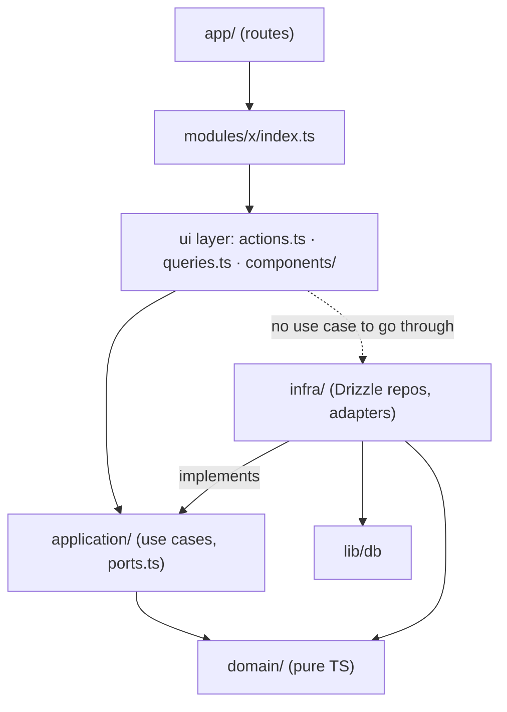

# Next.js Architecture Rules

Oct 29, 2026 · @Michael

## Purpose & principles

These rules apply to new Next.js projects and to refactoring existing ones. They optimize for four things, in this order:

1. **Business logic lives in TypeScript**, not in Postgres RPC, not in React components.
2. **End-to-end type safety**: one source of truth for each shape, inferred everywhere else.
3. **Developer experience**: a feature's code sits together; you can find it in one folder.
4. **Just enough layering**: layers exist to control dependency direction and make logic testable, not to satisfy a pattern. Where there are no rules, there is no domain layer.

When two rules conflict, the earlier one wins.

## Folder structure

Vertical modules (one per bounded context) with a light layering inside each. Routes stay thin. `lib/` holds cross-cutting code.

```
src/
  app/                          # routes only — composition, no business logic
    (app)/orders/
      page.tsx
      _components/              # route-local UI (option A, see below)
    api/                        # webhooks and route handlers only
  modules/
    orders/
      domain/                   # pure TS: types, invariants, domain errors
        order.ts
        money.ts
        errors.ts
      application/              # use cases + ports (optional, see Layer rules)
        create-order.ts
        ports.ts
      infra/                    # Drizzle repositories, external APIs
        order.repository.ts
      actions.ts                # server actions ("use server")  ─┐
      queries.ts                # cached reads for RSC            ├ ui layer
      components/               # feature UI (option B, see below) ─┘
      contracts.ts              # zod input/output contracts + DTO types
      index.ts                  # the module's public API
    billing/
    users/
  lib/
    db/                         # drizzle client + schema (see Schema placement)
    result.ts                   # Result<T, E>
    safe-action.ts              # next-safe-action client with auth middleware
    env.ts                      # validated env
  components/ui/                # shadcn/ui primitives
```

**Component placement (flexible, pick per case):**

- **Option A — `app/.../_components/`**: UI used by exactly one route. Page-specific layouts, wrappers, one-off forms.
- **Option B — `modules/<x>/components/`**: UI that belongs to the feature and is reused across routes, or needs the module's types and actions.
- **`components/ui/`**: shadcn/ui primitives and design-system atoms. Never feature-aware.

Rule of thumb: start in `_components/`; move to the module when a second route needs it.

**Schema placement (default centralized, not pinned):**

- Default: one Drizzle schema in `lib/db/schema.ts` (or `lib/db/schema/*.ts` split by table group). Relations across modules are easier to see in one place.
- Allowed: a module that owns tables nobody else touches may keep `modules/<x>/infra/schema.ts` and re-export it into `lib/db/schema.ts`. Drizzle still sees one schema; you just moved the file.
- Zod schemas (`contracts.ts`) always live in the module. They describe the module's API contracts, not tables, which is why the file is not called schema.

## Layer rules

Each layer may import only from the layers below it; the ui layer may skip application/ and call a repository directly when there is no logic to orchestrate (dashed arrow). Modules talk to each other only through `index.ts`.



Arrows show allowed imports. `infra/` is the only layer that imports a database client; it is reached through the port interface, never directly from a use case.

| Layer | Contains | May import | Never contains |
| --- | --- | --- | --- |
| `domain/` | types, branded value objects, invariant functions, tagged errors | nothing outside the module's `domain/` | I/O, Next, React, Drizzle, zod runtime calls |
| `application/` (optional) | use cases, `ports.ts` interfaces | `domain/`, `lib/result` | DB client, `fetch`, `cookies()`, `revalidate*` |
| `infra/` | repository implementations, API clients, mappers | `application/ports`, `domain/`, `lib/db` | business rules, validation of user input |
| ui layer: `actions.ts`, `queries.ts`, `components/` ¹ | server actions, cached queries, feature components | `application/`, `contracts.ts`, `lib/safe-action`; `infra/` repos directly only when there is no use case to go through | business rules beyond calling a use case or a repo |
| `app/` | pages, layouts, route handlers | `modules/*/index`, `components/ui` | direct DB calls, zod parsing, business rules |
| `lib/` | cross-cutting: db client, Result, env, safe-action | nothing from `modules/` | anything feature-specific |

**Hard rules:**

- **Skipping the application layer.** An action or query may call a repository directly when it needs no orchestration: a plain read, a single write with validation only, no business decision. The moment it needs a transaction, a domain function, a second repository or an `if` about business state, extract a use case. The test: if you'd want to unit-test it without Next, it's a use case.
- A use case receives its dependencies (repos, clock, id generator) as arguments or via a tiny factory next to `actions.ts`. No global singletons inside `application/`.
- Errors cross layer boundaries as values (`Result`), never as thrown exceptions. Throwing is reserved for bugs.
- Enforce the direction with `eslint-plugin-boundaries` (or `dependency-cruiser`) in CI from day one. A rule nobody checks is a suggestion.
- If two modules import each other, merge them or extract a third. Cyclic modules are a boundary mistake.

¹ `actions.ts`, `queries.ts` and `components/` sit at the module root to save a folder level, but they are the **ui layer** in the layered/clean-architecture sense. In particular `page.tsx`, `actions.ts` and `queries.ts` play the role of the *controller* (or *interface adapter*) in most DDD books and docs: they translate HTTP/React into use-case calls and back. Keep that mapping in mind when reading outside material.

## Type safety chain

Every shape has exactly one source of truth; everything else is inferred. If you write the same type twice by hand, one of them is wrong already.

| Shape | Source of truth | Inferred by |
| --- | --- | --- |
| Table rows | Drizzle schema | `InferSelectModel` / `InferInsertModel` in `infra/` |
| Request/response DTOs | zod in `modules/<x>/contracts.ts` | `z.infer` in use cases, actions, forms |
| Domain types | `domain/*.ts` (plain types + branded primitives) | mappers in `infra/` convert rows to these |
| Use case outcome | `Result<T, DomainError>` from `lib/result.ts` | actions switch on `error._tag` |
| Server action contract | `next-safe-action` wrapping the zod input | `useAction` / `useOptimisticAction` on the client |
| Env vars | `lib/env.ts` (t3-env or zod) | `env.X`, fails at build if missing |
| Routes | `typedRoutes: true` in `next.config` | `<Link href>` and `redirect()` |

**Rules:**

- Never `as` cast across a layer boundary. If the types don't line up, add a mapper in `infra/` or fix the schema.
- Use cases return `Result`, never throw. Actions translate `Result` into `{ data } | { serverError } | { validationErrors }`, which `next-safe-action` already types for the client.
- Validate at the edge once (server action input, webhook payload, env). Inside the module, trust the types.
- Domain errors are a tagged union (`{ _tag: 'OrderAlreadyPaid' }`). Exhaustive `switch` in the action; the compiler catches a missing case.
- Forms use the same zod schema via `react-hook-form` + `zodResolver`. Client and server disagree on nothing.
- Branded primitives for ids and money (`type OrderId = string & { __brand: 'OrderId' }`). It costs one line and stops `userId` landing in `orderId`.

## Database & Postgres RPC rule

**Business logic lives in TypeScript. Postgres RPC (functions called via `rpc()` or `SELECT fn()`) is allowed only for timing-critical transactions.** Everything else is a query the repository runs through Drizzle.

Why: RPC is invisible to the type system, untestable without a database, bypasses `Result` error handling, and splits one feature across two languages and two deploy pipelines. Every project we have that drifted into RPC is now hard to refactor for exactly these reasons.

**RPC is allowed when all of these hold:**

1. The operation needs multiple statements in one transaction **and** the round-trips between app and DB would make it fail its latency budget or create a race (e.g. inventory reservation under contention, counter increments, queue claim-and-lock).
2. The function contains **no business rules** beyond the atomic write: no pricing, no status decisions, no notifications. It takes already-validated inputs and performs the transactional write.
3. It is wrapped by exactly one repository method in `infra/`, with a zod schema for its result, so the rest of the code never sees the RPC.
4. It has a migration file in the repo and a test that runs it against a real database.

**Not a valid reason for RPC:** "it's easier in SQL", "Supabase makes it convenient", "to avoid the N+1" (use a join or a CTE in Drizzle), "to enforce permissions" (use RLS policies for row access; keep authorization decisions in the use case).

**Other DB rules:**

- Transactions are opened in the use case through a `UnitOfWork` port or a `withTransaction(tx => …)` helper exposed by `infra/`. Drizzle's `db.transaction()` is the implementation.
- Triggers are limited to `updated_at` and audit columns. No trigger may change another table's business data.
- Views are fine for read models; they are typed via Drizzle's `pgView`.
- RLS enforces tenant isolation, not business rules.

## When to go rich vs anemic

A module gets a `domain/` layer only when it has invariants. Otherwise it is a CRUD module and the full layering is overhead.

| Signal | Rich (full layering) | Anemic (CRUD module) |
| --- | --- | --- |
| State transitions with rules (draft → paid → shipped) | yes | — |
| Calculations that must agree everywhere (totals, tax, quotas) | yes | — |
| Two or more use cases touch the same entity | yes | — |
| Logic currently in a Postgres function or trigger | yes, move it here | — |
| Plain create/read/update/delete with validation only | — | yes |
| Settings, profiles, lookup tables | — | yes |

**Anemic module shape:** `contracts.ts` + `queries.ts` + `actions.ts` + `index.ts`. Actions and queries call Drizzle directly through a thin `infra/` repo or even inline. No `domain/`; the `application/` folder does not exist until promotion.

**Promotion rule:** the moment an action contains an `if` about business state, or a second action needs the same calculation, extract a use case and a `domain/` file. Don't pre-build the layers; don't resist them either once the signal appears.

**What "rich" means here:** plain types and pure functions, not classes with methods. `applyPayment(order, payment): Result<Order, OrderError>` is a rich domain. It is serializable, testable with no setup, and works across the server/client boundary.

## Refactoring playbook for existing projects

Refactor one module at a time, strangler-style. Never a big-bang restructure; the old and new structure coexist until the last module moves.

1. **Add the guardrails first.** Install `eslint-plugin-boundaries` with the target rules but every existing violation whitelisted. New code must comply; old code shows up in the lint report. Add `lib/result.ts` and `lib/safe-action.ts`.
2. **Inventory the RPC.** List every Postgres function and trigger: name, who calls it, what business rule it contains, whether it meets the RPC exception. Put the list in a table in this doc or the repo. Most will fail criterion 2 (contains business rules).
3. **Pick the module with the most pain**, usually the one with the most RPC or the most duplicated logic. Create `modules/<x>/` with just `index.ts` and `contracts.ts`.
4. **Move reads first.** Create `queries.ts` with Drizzle queries replacing the RPC reads. Reads are safe to swap and give you typed row shapes to build on.
5. **Port one RPC write at a time into a use case.** Copy the SQL function's logic into `application/<use-case>.ts` as TypeScript; the transactional write becomes a repository method. Keep the SQL function in place and run both, comparing results, until the TS version has been live for a release. Then drop the function in a migration.
6. **Extract invariants into `domain/`** as the use cases reveal them. If a rule lived in a trigger, it moves here, not into the repository.
7. **Rewire the routes.** Pages and actions under `app/` import only from `modules/<x>/index`. Delete the old `lib/` or `services/` helpers the module replaced.
8. **Remove the whitelist entry** for that module. The lint rule now protects it.
9. **Repeat** with the next module. Each pass is one PR series, mergeable independently.

**Rules during the transition:**

- No new RPC may be added unless it passes the exception criteria, even in untouched modules.
- No new code imports from an old helper that a module already replaced.
- A module that is half-migrated is marked with a `MIGRATING.md` listing what still bypasses it, so nobody assumes it is the single source of truth yet.
- If a migration step reveals two modules were really one, merge them before continuing.

## Checklist

Copy into a PR template or `ARCHITECTURE.md`.

- [ ] Business logic is in TypeScript, not in Postgres RPC or triggers
- [ ] Any RPC passes all four exception criteria and is wrapped by one repository method
- [ ] Each feature lives in `modules/<x>/` with a public `index.ts`; routes import only from it
- [ ] `domain/` exists only where invariants exist; CRUD modules stay flat
- [ ] `domain/` imports nothing outside the module; `application/` imports no I/O
- [ ] Use cases return `Result`, never throw; actions switch exhaustively on the error tag
- [ ] One source of truth per shape: Drizzle for rows, zod for DTOs, inferred everywhere else
- [ ] Server actions go through `next-safe-action` with the module's zod schema
- [ ] No `as` casts across layer boundaries
- [ ] Route-only UI in `_components/`; shared feature UI in `modules/<x>/components/`; primitives in `components/ui/`
- [ ] Drizzle schema centralized in `lib/db/` unless a module owns its tables outright
- [ ] Dependency direction enforced by ESLint in CI
- [ ] Transactions opened in the use case via a port, implemented in `infra/`
